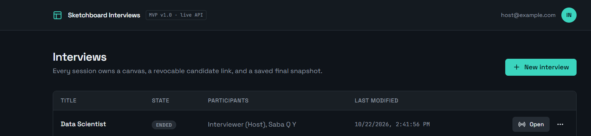
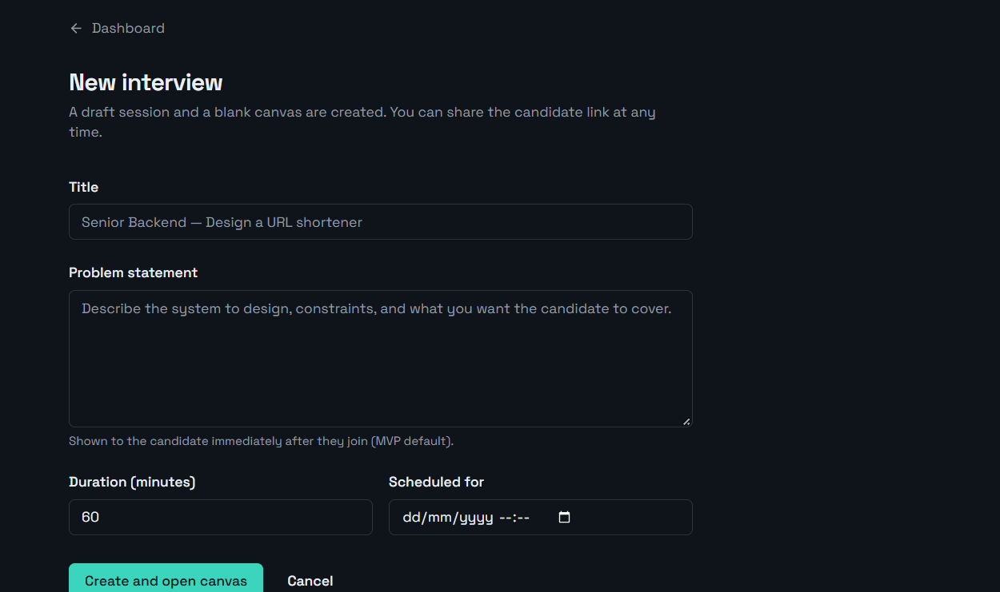
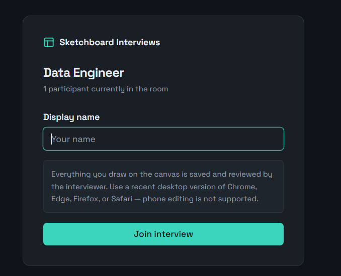
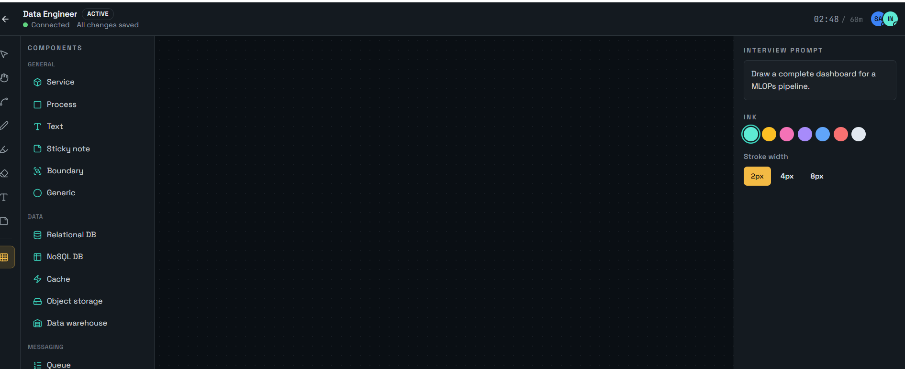

# 📖 User & Candidate Onboarding Guide

This guide details how to launch a session, configure interview details, and onboard candidates into the live collaborative canvas.

---

## Step 1: Launch & Access the Dashboard

Navigate to [interview-canvas-prod](https://interview-canvas-prod.onrender.com) upon launching the service. 

---

## Step 2: Create a New Interview Session

1. Click **+ New interview** on the top right of the dashboard.



## Step 3: Full in the form
Complete the session parameters:
   - **Title**: Role and topic (e.g., *ML Engineer — Design Real-time Pipeline*).
   - **Problem statement**: Describe constraints, system requirements, and candidate expectations.
   - **Duration & Schedule**: Set session length (e.g., 60 minutes) and optional start date.
3. Click **Create and open canvas**.


---

## Step 4: Invite the Candidate to the Canvas

1. Inside the workspace, click the **Share** button in the top navigation bar.
2. Copy the candidate join URL:
   ```text
   [https://interview-canvas-prod.onrender.com/join/](https://interview-canvas-prod.onrender.com/join/)<session_id>


---
## Step 5: After Sharing the Interview link
A candidate opens the link, and fill in his name.



---
## Step 6: The candidate navigate to the same Interview canvas

