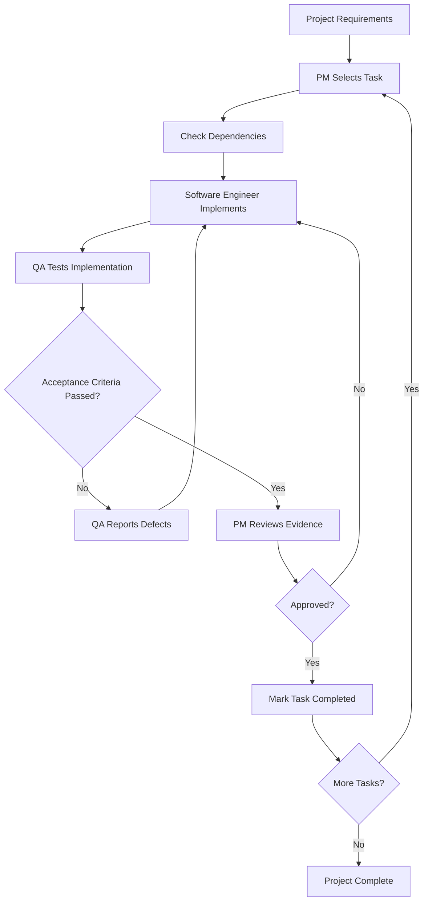

# Development Process: From AI-Assisted Prototype to Production

## 1. Purpose

This document describes the development process used to build the System Design Interview Platform, from adopting an existing frontend to deploying a containerized application with automated testing, CI/CD, observability, and incident response.

The process follows the hands-on development methodology practiced during the DataTalksClub LLMs & AI Engineering Zoomcamp training. It is organized into four main modules and is intended to be reusable for future software projects.

A second objective is to make the process suitable for AI-assisted software development. Each module can be decomposed into independent tasks with explicit objectives, dependencies, acceptance criteria, and validation steps. These tasks will eventually be executed through a multi-agent workflow involving a Project Manager (PM), a Software Engineer, and a QA Engineer.

**Important:** This document describes the development process and the intended reusable workflow. It does not instruct agents to rebuild the existing Interview Canvas application. The application serves as the completed project and reference implementation.

## 2. Project Overview

The System Design Interview Platform is a real-time collaborative workspace for conducting system-design interviews.

The application consists of:

- **Frontend:** React and Vite, providing the collaborative canvas.
- **Backend:** FastAPI, exposing REST endpoints and WebSocket communication.
- **Database:** PostgreSQL for persistent application data.
- **Containerization:** Docker and Docker Compose.
- **Testing:** Backend unit and integration tests, together with Playwright end-to-end tests.
- **CI/CD:** GitHub Actions and GitHub Container Registry (GHCR).
- **Deployment:** Separate development and production services hosted on Render.
- **Observability:** OpenTelemetry with Grafana Cloud, using Prometheus, Loki, and Tempo.
- **Incident response:** A separate FastAPI service that receives Grafana alert payloads and saves incident evidence.

The development process follows four modules:

1. Frontend setup and mock-backend prototyping.
2. Backend implementation and database integration.
3. Containerization and automated testing.
4. Multi-environment deployment, observability, and incident response.

---

# Module 1 — Frontend Setup and Mock-Backend Prototyping

## 3. Objective

Establish a working frontend before implementing the actual backend.

The approach was to adopt the existing frontend from Alexey Grigorev's `interview-canvas-share` repository rather than generate an entirely new interface. This reduced development effort and allowed the work to focus on the backend, infrastructure, and observability.

Repository: [Alexey Grigorev's interview-canvas-share](https://github.com/alexeygrigorev/interview-canvas-share/tree/main/frontend)

## 3.1 Task 1.1 — Adopt the Existing Frontend

### Objective

Reuse the existing React/TypeScript frontend as the starting point.

### Actions

1. Inspect the existing frontend structure and identify the application entry point, components, dependencies, and configuration.
2. Obtain the frontend source code from the existing repository.
3. Integrate the frontend into the new project repository.
4. Inspect its dependencies on backend endpoints, WebSockets, authentication, and application data.
5. Identify the changes required to run the frontend independently of the real backend.

### Expected result

The project contains the adopted frontend source code and a clear understanding of its backend dependencies.

## 3.2 Task 1.2 — Replace Backend Dependencies with Mock Behavior

### Objective

Make the frontend usable without requiring a working backend or database.

### Actions

1. Identify components that expect data from backend endpoints.
2. Replace or adapt the necessary backend interactions to use mock data, local state, or mock handlers.
3. Provide suitable local data for the interface to display.
4. Ensure the main canvas interactions can be exercised without live database calls.
5. Keep the frontend independent enough to support visual development before the real backend is available.

Examples of interactions to validate include:

- Displaying the interview canvas.
- Placing or manipulating canvas components.
- Drawing connections.
- Adding notes.
- Exercising the relevant interface controls.

Mock behavior is intended for frontend development. It must not be confused with the real persistence and synchronization implemented in later modules.

## 3.3 Task 1.3 — Fix the Frontend and Run It Locally

### Objective

Resolve the configuration or code issues preventing the adopted frontend from running independently.

### Actions

1. Inspect package configuration and frontend scripts.
2. Install the required dependencies.
3. Fix relevant imports, configuration, and mock-backend integration issues.
4. Run the frontend development server.
5. Verify that the application loads and the intended interactions work.

### Example validation commands

```bash
cd frontend
npm install
npm run dev
```

These are representative commands for a Vite frontend. The exact commands used during the original work should be confirmed against the project's package scripts and historical documentation.

A production-build check can also be performed:

```bash
npm run build
```

### Acceptance criteria

- [ ] The adopted frontend is integrated into the project.
- [ ] Required backend interactions have suitable mock behavior.
- [ ] The frontend starts locally without requiring the real backend.
- [ ] The main canvas interactions can be exercised.
- [ ] The frontend builds successfully.

### Deliverable

A working frontend prototype that can be developed independently of the backend.

---

# Module 2 — Backend Development and Database Integration

## 4. Objective

Replace the temporary frontend behavior with a real backend and progressively introduce persistent storage.

The development approach was incremental: first establish the backend communication, then add a lightweight database, and finally move to PostgreSQL.

## 4.1 Task 2.1 — Implement the FastAPI Backend

### Objective

Create a backend that can serve the frontend and manage application operations.

### Actions

1. Set up a Python backend using FastAPI.
2. Implement REST endpoints for the application's operations.
3. Add WebSocket communication for real-time canvas updates.
4. Connect the frontend to the backend.
5. Initially store application state in Python memory using appropriate data structures.
6. Validate communication between the frontend and backend.

### Acceptance criteria

- [ ] The FastAPI application starts successfully.
- [ ] Required REST endpoints respond correctly.
- [ ] WebSocket connections can be established.
- [ ] The frontend can communicate with the backend.
- [ ] Basic application operations work with in-memory state.

### Deliverable

A functional frontend and backend communicating without persistent database storage.

## 4.2 Task 2.2 — Introduce SQLAlchemy and SQLite

### Objective

Replace temporary in-memory application data with persistent local storage.

### Actions

1. Introduce SQLAlchemy models for the relevant application entities, such as sessions, shapes, and connections.
2. Configure a local SQLite database.
3. Replace in-memory persistence with database operations.
4. Validate the creation and retrieval of application data.
5. Restart the application and verify that stored data remains available.

The initial local database was identified as `interview.db` in the development process.

### Acceptance criteria

- [ ] SQLAlchemy models represent the required entities.
- [ ] The backend can read and write application data using SQLite.
- [ ] Data survives application restarts.
- [ ] Existing application operations remain functional.

### Deliverable

A backend using SQLAlchemy and persistent local SQLite storage.

## 4.3 Task 2.3 — Migrate to PostgreSQL

### Objective

Prepare the application for containerized and hosted environments using PostgreSQL.

### Actions

1. Configure PostgreSQL as the database backend.
2. Update the database connection configuration.
3. Adapt the application's database initialization and migration procedures as required.
4. Configure database connection handling and pooling.
5. Add or verify a database health-check endpoint.
6. Run backend tests against the updated database configuration.

The connection configuration should be environment-specific rather than hardcoded into application logic.

### Acceptance criteria

- [ ] The backend can connect to PostgreSQL.
- [ ] Required database operations work.
- [ ] Database connectivity can be checked.
- [ ] Automated tests cover the relevant backend behavior.
- [ ] The application no longer depends on SQLite for its hosted deployment.

### Deliverable

A backend that supports PostgreSQL for hosted environments while retaining an appropriate local development setup.

## 4.4 Task 2.4 — Add Automated Backend Tests and Makefile Commands

### Objective

Make backend validation repeatable and easy to execute.

### Actions

1. Write unit tests for backend logic.
2. Write integration tests for relevant routes and database operations.
3. Add tests for important WebSocket behavior where applicable.
4. Use pytest to execute the tests.
5. Create or update Makefile targets for common development commands.

The project includes commands for starting the backend, running tests, and starting the frontend.

Representative commands include:

```bash
cd backend
poetry run pytest tests/ -v
```

The exact Makefile targets should be checked against the repository before documenting their final names.

### Acceptance criteria

- [ ] Backend tests can be executed repeatably.
- [ ] Tests cover important application behavior.
- [ ] Common development operations have documented commands.
- [ ] Test failures are visible and can be investigated.

### Deliverable

A backend with automated tests and repeatable development commands.

---

# Module 3 — Containerization and Automated Testing

## 5. Objective

Package the application and its dependencies into containers, establish a reproducible local environment, and automate end-to-end testing.

This module builds on the working frontend and backend from Modules 1 and 2.

## 5.1 Task 3.1 — Create the Docker Image

### Objective

Package the frontend and backend into a container that can be built consistently.

### Actions

1. Create a Dockerfile for the application.
2. Configure a frontend build stage to install dependencies and compile the frontend assets.
3. Configure the backend stage with Python and the required application dependencies.
4. Copy the compiled frontend assets into the backend's static-file location.
5. Configure the application to serve the frontend and backend from the container.
6. Expose the required application port.

The project uses a multi-stage Docker build to separate frontend compilation from the runtime image.

### Acceptance criteria

- [ ] The Docker image builds successfully.
- [ ] The frontend assets are included in the final image.
- [ ] FastAPI starts correctly in the container.
- [ ] The application can be accessed through the exposed port.

### Deliverable

A containerized application that can run without manually setting up its frontend and backend environments.

## 5.2 Task 3.2 — Orchestrate the Application with Docker Compose

### Objective

Run the application and PostgreSQL together in a reproducible local environment.

### Actions

1. Configure the application and database services in Docker Compose.
2. Configure PostgreSQL credentials, database settings, and persistent storage as appropriate.
3. Set up the application-to-database connection.
4. Configure a shared container network.
5. Add database health checks.
6. Ensure the application starts only when its database dependency is ready.

### Acceptance criteria

- [ ] The application and database start using Docker Compose.
- [ ] The backend can connect to PostgreSQL.
- [ ] Database readiness is checked.
- [ ] The complete stack can be started using documented commands.

### Deliverable

A local containerized application stack with PostgreSQL.

## 5.3 Task 3.3 — Implement Automated End-to-End Tests

### Objective

Verify that the complete application behaves correctly from the user's perspective.

Unit and integration tests validate individual components and backend behavior. End-to-end tests validate the complete user workflow across the frontend, backend, and database.

### Actions

1. Use Playwright to automate browser interactions.
2. Test opening the application and creating an interview session.
3. Test generating and using a candidate invitation or sharing link.
4. Test joining a session as a candidate.
5. Verify that canvas changes are synchronized between participants.
6. Run the tests against the containerized application.
7. Use a Makefile target to simplify execution.

The project uses a temporary containerized Playwright environment so that the test workflow does not require manually installing and configuring a browser on the developer's machine.

### Example validation command

```bash
make run-e2e
```

The exact behavior of this target should be verified against the current Makefile.

### Acceptance criteria

- [ ] The E2E workflow starts the required services.
- [ ] The tests wait for the required services to become ready.
- [ ] Session creation and candidate joining are tested.
- [ ] Collaborative canvas synchronization is tested.
- [ ] Test failures cause the E2E test run to fail visibly.
- [ ] The workflow can be repeated using a documented command.

### Deliverable

An automated end-to-end test suite that validates important user journeys.

## 5.4 Task 3.4 — Integrate Automated Checks into CI/CD

### Objective

Run automated validation before publishing a new application image.

### Actions

1. Configure GitHub Actions workflows.
2. Run backend code-quality checks.
3. Run backend unit and integration tests.
4. Run the containerized E2E test suite.
5. Build the application image after the required validation jobs succeed.
6. Publish the image to GitHub Container Registry.

The project subsequently developed a three-job workflow covering quality and unit tests, E2E tests, and image building and publishing.

### Acceptance criteria

- [ ] Automated checks run through GitHub Actions.
- [ ] Failed required checks prevent the image-publishing stage from proceeding.
- [ ] The image can be published to GHCR.
- [ ] The resulting image can be identified by its tag.

### Deliverable

An automated validation and image-publishing pipeline.

---

# Module 4 — Production Workflow, Observability, and Incident Response

## 6. Objective

Extend the containerized application into a controlled multi-environment deployment, make application behavior observable, and establish an alert-to-incident-evidence workflow.

The implementation follows this sequence:

1. Configure development and production environments.
2. Automate image publishing and deployment.
3. Isolate environment data.
4. Add OpenTelemetry instrumentation.
5. Build Grafana dashboards and configure alerting.
6. Deploy the incident responder and connect it to Grafana.

## 6.1 Task 4.1 — Configure Development and Production Services

### Objective

Separate development testing from production usage.

### Actions

1. Create a development web service on Render.
2. Create a separate production web service on Render.
3. Configure both services to use the application container image from GHCR.
4. Set environment-specific configuration values.
5. Configure the development service for automated deployments.
6. Configure production deployment as a controlled promotion process.

The project uses the following logical environments:

| Environment | Purpose | Deployment strategy |
|---|---|---|
| Development | Validate new application changes | Automated deployment |
| Production | Serve the production application | Manual promotion of a selected image |

### Acceptance criteria

- [ ] Development and production are separate Render services.
- [ ] Each service uses the intended application image.
- [ ] Environment-specific settings are configured.
- [ ] Development changes can be deployed independently of production promotion.

### Deliverable

Separate development and production application services.

## 6.2 Task 4.2 — Automate Image Publishing and Deployment

### Objective

Establish a repeatable CI/CD process from code changes to deployment.

### Actions

1. Configure GitHub Actions to run quality checks and backend tests.
2. Run automated E2E tests.
3. Build the Docker image.
4. Publish the image to GHCR.
5. Tag images to support version identification and promotion.
6. Configure the development deployment trigger.
7. Create a manually triggered GitHub Actions workflow to promote a selected image to production.

The project's image-tagging strategy includes date-and-commit-based tags and a `latest` tag.

### Acceptance criteria

- [ ] The required validation stages run before image publishing.
- [ ] Images are published to GHCR with identifiable tags.
- [ ] Development deployments can be triggered automatically.
- [ ] Production promotion can select a specific image version.
- [ ] The promoted image can be traced to its build.

### Deliverable

A CI/CD pipeline that separates automated development deployment from controlled production promotion.

## 6.3 Task 4.3 — Isolate Development and Production Database Data

### Objective

Prevent development operations from interfering with production data.

### Actions

1. Configure PostgreSQL for the hosted environments.
2. Create separate `dev` and `prod` schemas.
3. Configure the development database connection to use the `dev` schema.
4. Configure the production database connection to use the `prod` schema.
5. Verify that queries, writes, and schema initialization operate in the intended environment.

The project uses one Render PostgreSQL instance with separate schemas to fit the selected hosting arrangement.

The development connection includes a schema-specific search-path option, while production uses its intended schema configuration.

The exact connection strings and initialization behavior must be taken from the repository and Render configuration.

### Acceptance criteria

- [ ] The development service uses the `dev` schema.
- [ ] The production service uses the `prod` schema.
- [ ] Environment-specific operations target the intended schema.
- [ ] Development testing does not modify production data.

### Deliverable

Environment-level database separation using PostgreSQL schemas.

## 6.4 Task 4.4 — Instrument FastAPI with OpenTelemetry

### Objective

Collect application telemetry to support monitoring, troubleshooting, and performance analysis.

### Actions

1. Integrate the OpenTelemetry SDK into the FastAPI application.
2. Configure instrumentation for relevant HTTP requests and application operations.
3. Configure metric, trace, and log exporters.
4. Export telemetry using OTLP over HTTP to Grafana Cloud.
5. Configure the necessary endpoint, authentication headers, and service-name environment variables.
6. Ensure logs can include trace and span identifiers for correlation.
7. Verify that telemetry from the development and production services is distinguishable.

The project uses the following telemetry components:

- **Metrics:** Prometheus.
- **Logs:** Loki.
- **Traces:** Tempo.

The instrumentation configuration is maintained in `telemetry.py` within the backend application.

### Acceptance criteria

- [ ] The application exports metrics.
- [ ] Distributed traces are available in Tempo.
- [ ] Application logs are available in Loki.
- [ ] Environment-specific telemetry can be identified.
- [ ] Trace and span identifiers support investigation across logs and traces.

### Deliverable

An instrumented FastAPI application exporting telemetry to Grafana Cloud.

## 6.5 Task 4.5 — Build Grafana Dashboards

### Objective

Make application health and performance visible through dashboards.

### Actions

1. Configure Grafana Cloud data sources for metrics, logs, and traces.
2. Create Prometheus panels for request rates and HTTP status distributions.
3. Add request latency percentile visualizations, including p50, p90, and p99 where appropriate.
4. Create Loki panels for application logs.
5. Create Tempo panels to inspect traces and request execution.
6. Configure Loki derived fields to link log entries to the corresponding Tempo traces.
7. Validate the dashboard using telemetry from the deployed services.

The project uses PromQL for metrics, LogQL for logs, and TraceQL for trace queries.

### Acceptance criteria

- [ ] The dashboard displays application metrics.
- [ ] HTTP status distributions can be inspected.
- [ ] Request latency can be analyzed.
- [ ] Application logs can be queried.
- [ ] Traces can be inspected.
- [ ] Log-to-trace navigation works when the required identifiers are present.

### Deliverable

A Grafana Cloud dashboard for monitoring and troubleshooting the application.

## 6.6 Task 4.6 — Configure Grafana Alerting

### Objective

Detect relevant application problems and notify the team.

### Actions

1. Create Grafana alert rules for the FastAPI application.
2. Configure the alert evaluation interval and pending period.
3. Monitor HTTP error responses.
4. Monitor request latency using a configured percentile threshold.
5. Configure an email contact point.
6. Connect the alert rules to the relevant notification policies or contact points.
7. Validate the rules and notification delivery.

The project uses a Grafana alert group named `fastapi-monitoring`. The documented configuration uses a one-minute evaluation interval and a two-minute pending period.

The exact alert expressions and thresholds must match the current Grafana configuration. They should not be inferred from an older version of the dashboard or README.

### Acceptance criteria

- [ ] The alert rules evaluate the intended application signals.
- [ ] Error and latency conditions are configured.
- [ ] Alert state changes can trigger email notifications.
- [ ] The notification configuration is validated.

### Deliverable

Grafana alerting that can notify the team when configured conditions are met.

## 6.7 Task 4.7 — Implement the Incident Responder Service

### Objective

Provide a webhook endpoint that receives Grafana alert payloads and saves incident evidence for later investigation.

### Actions

1. Create a separate FastAPI service in `incident_response/responder.py`.
2. Implement a health-check endpoint.
3. Implement the `/alerts` endpoint to receive alert payloads.
4. Parse incoming Grafana alert data.
5. Schedule background processing for each received alert.
6. Save each alert payload as a JSON evidence file in the `incidents/` directory.
7. Deploy the incident responder service on Render.
8. Configure the Grafana webhook contact point to send alert payloads to the deployed responder endpoint.
9. Verify that alerts reach the service and that the payloads are processed as expected.

The incident responder is separate from the main Interview Canvas backend. Its responsibility is to receive and process monitoring alerts.

### Acceptance criteria

- [ ] The responder starts as a separate FastAPI service.
- [ ] Its health endpoint returns a successful response.
- [ ] The `/alerts` endpoint accepts the expected webhook requests.
- [ ] Alert payloads are processed in the background.
- [ ] Incident evidence is saved as JSON.
- [ ] Grafana is configured with the correct responder URL.
- [ ] The webhook integration is tested end to end.

### Deliverable

A deployed incident responder connected to Grafana alerting.

### Important implementation limitation

The current responder includes a placeholder for invoking an AI coding assistant in headless mode. The actual AI-agent execution and automated remediation are not implemented.

The implemented workflow should therefore be described as **automated alert reception and evidence collection**, not fully autonomous incident resolution.

The persistence of evidence files also depends on the deployed filesystem configuration. If the hosting service does not use persistent storage, local files may not survive restarts or redeployments.

---

# 7. Reusable Task Specification for Future Agents

The modules above describe the development process. To make that process executable by AI agents on another project, each task should be converted into a structured task specification.

Every task should contain the following fields.

## 7.1 Task Template

```markdown
# Task ID: TASK-XXX

## Title
A short description of the task.

## Objective
What the task must accomplish.

## Context
Relevant project information and existing decisions.

## Dependencies
Tasks that must be completed first.

## Inputs
Required files, configurations, and information.

## Implementation Steps
An ordered list of actions.

## Files and Components
Expected areas of the project to inspect or modify.

## Acceptance Criteria
Conditions that must be satisfied.

## Validation
Commands, tests, and manual checks used to verify the result.

## Deliverables
Code, configuration, tests, or documentation produced.

## Risks and Constraints
Important limitations and rules.

## Status
Pending / In Progress / In Review / Failed / Completed.

## Results
Implementation summary and validation evidence.
```

The template is intended to keep tasks small, verifiable, and independent where possible.

Historical details must be documented using evidence from the existing repository, configuration, or development notes. Unknown historical actions should be marked as unverified rather than invented.

# 8. Planned Multi-Agent Development Workflow

The future objective is to use the documented process as the basis for a multi-agent software development workflow.

The initial roles will be:

## 8.1 Project Manager Agent

Responsibilities:

- Read the project requirements and development roadmap.
- Select the next eligible task.
- Check task dependencies.
- Assign work to the Software Engineer Agent.
- Review implementation and QA reports.
- Approve completed tasks or request further work.
- Escalate unresolved problems to the project owner.

The PM should not mark a task complete merely because the Software Engineer reports success.

## 8.2 Software Engineer Agent

Responsibilities:

- Inspect the existing project before making changes.
- Implement the assigned task within its defined scope.
- Follow existing architecture and coding conventions.
- Add or update tests as required.
- Run the available validation commands.
- Report files changed, decisions made, test results, and known limitations.

The Software Engineer should not silently expand the task scope or mark unverified acceptance criteria as passed.

## 8.3 QA Engineer Agent

Responsibilities:

- Review the task's acceptance criteria.
- Independently verify the implementation.
- Run the relevant automated tests.
- Perform additional checks where necessary.
- Report reproducible defects and missing evidence.
- Return failed tasks for correction.
- Approve the task only when the required criteria are satisfied.

QA should verify the actual implementation rather than rely exclusively on the Software Engineer's summary.

## 8.4 Task Handoff and Feedback Loop

The intended workflow is:

1. The PM selects a task whose dependencies are satisfied.
2. The PM provides the task specification to the Software Engineer.
3. The Software Engineer implements the task and returns the result.
4. QA validates the implementation against the acceptance criteria.
5. If QA identifies defects, the task returns to the Software Engineer with a clear defect report.
6. The Software Engineer fixes the defects and submits the implementation for another QA review.
7. Once QA passes the task, the PM reviews the evidence and approves completion.
8. The PM advances to the next eligible task.

A retry limit and escalation mechanism should prevent agents from repeating the same unsuccessful steps indefinitely.

## 8.5 Planned Agent Workflow



This workflow is a design target. The actual orchestration mechanism and the degree of agent autonomy will be determined when the framework is implemented.

# 9. Using Cline and Ollama

Cline with Ollama is the starting point for experimenting with the agent workflow using locally available models.

The planned approach is to:

1. Define the responsibilities and instructions for each agent role.
2. Store the development roadmap and task specifications in version control.
3. Provide each agent with the context and tools required for its assigned work.
4. Establish explicit handoff formats for implementation results and QA reports.
5. Introduce a task-status mechanism to track progress.
6. Test the workflow on a separate project before considering it ready for broader use.

The first implementation should be kept simple. Separate role instructions and a manually coordinated workflow can establish whether the task contracts and acceptance criteria work before introducing a more complex orchestration system.

The available Cline and Ollama capabilities should be verified before assuming that the roles can run as fully independent agents or invoke tools reliably.

# 10. Completion Criteria for the Development Playbook

The development playbook is ready for reuse when:

- [ ] The four modules are documented in their actual development order.
- [ ] Tasks have clear objectives, dependencies, and acceptance criteria.
- [ ] Validation steps are documented where they can be verified.
- [ ] Historical facts are distinguished from proposed future practices.
- [ ] Known limitations are explicitly recorded.
- [ ] The task template is suitable for other software projects.
- [ ] PM, Software Engineer, and QA Engineer responsibilities are defined.
- [ ] The handoff, feedback, approval, and escalation process is documented.
- [ ] The workflow can be trialed on a different project without modifying the completed Interview Canvas application.

## 11. Final Outcome

The Interview Canvas project demonstrates an end-to-end development journey: beginning with an adopted frontend and mock behavior, progressing through backend development and persistent storage, adding containerization and automated E2E testing, and finishing with multi-environment deployment, observability, and incident evidence collection.

The next stage is to turn this experience into a reusable AI-assisted software development framework. The documented tasks will provide the execution plan, the agent definitions will establish responsibilities, and the QA feedback loop will provide a repeatable mechanism for validating work before advancing to the next task.
